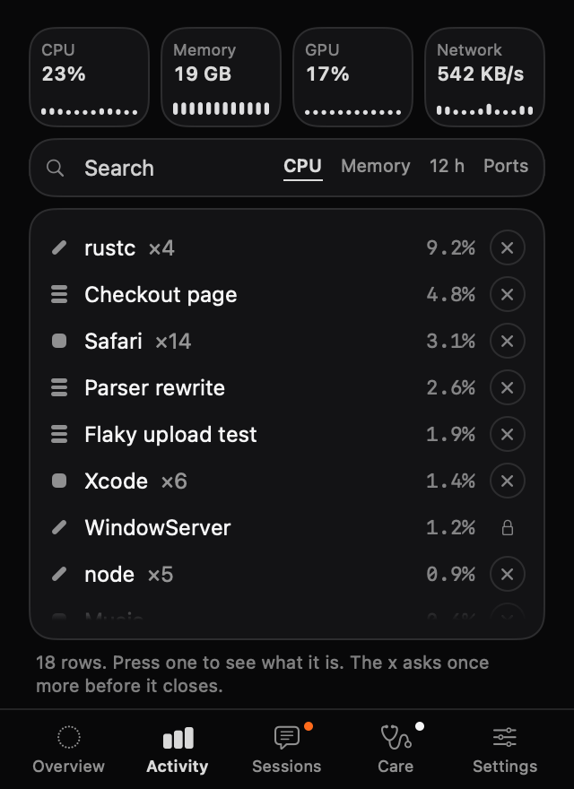
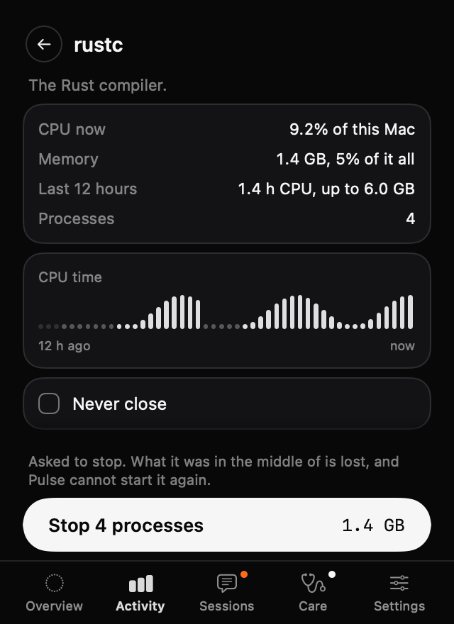
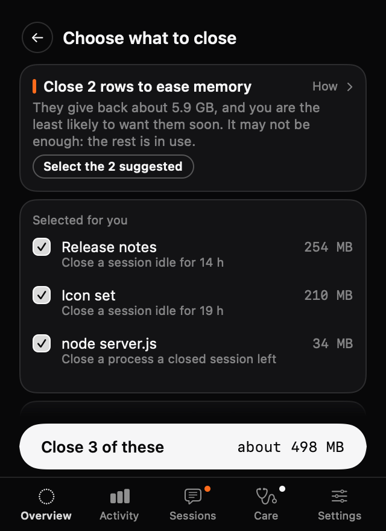
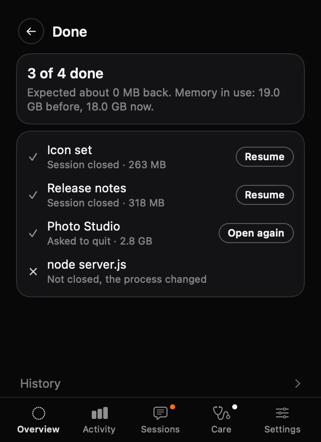
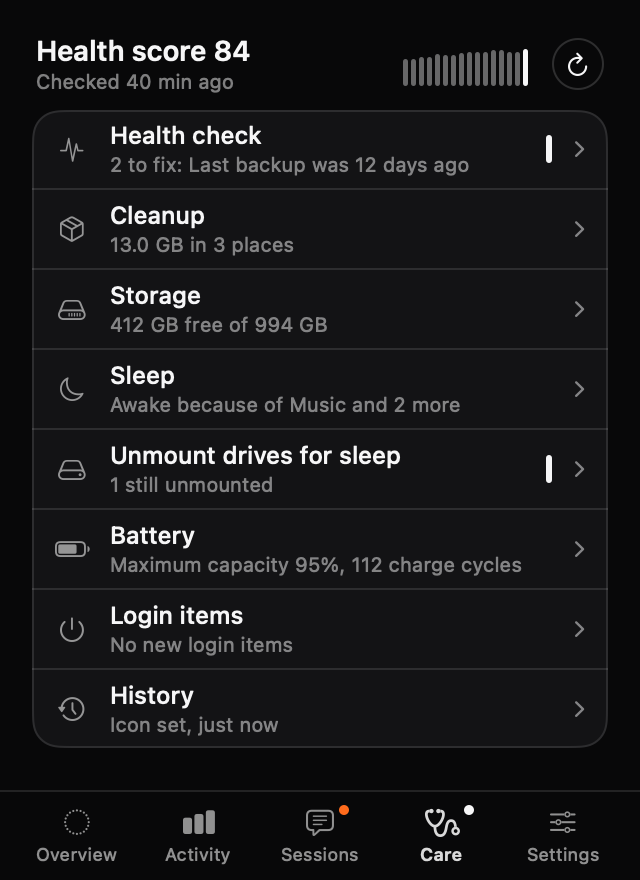

# Pulse

A small menu bar app that answers one question: is there anything on this Mac that needs you?
What does comes first, with the one place where it is dealt with. The rest is a press away.

<p>
  
  
  
</p>
<p>
  
  
  
</p>

## Five places

- **Overview.** A health score, four figures, and one list: sessions that need input, memory pressure, heat, findings, space. The costliest first, "Hide until tomorrow" for what can wait.
- **Activity.** Live CPU, memory, graphics and network. Every row now, over the last twelve hours, or by its open port.
  A row has a page: what it is, what it costs, when it was busy, what it listens on, and what closing it would lose.
- **Sessions**, when Claude Code is installed. Its sessions by state: needs input, working, idle, or status unknown; on request, plan limits.
- **Care.** A health check every six hours, cleanup, storage and SSD wear, sleep, drives to unmount for sleep, battery, login items and who signed them, and the history of what Pulse did.
- **Settings.** What the menu bar shows, silent notifications, closing rules, a keyboard shortcut, connecting an agent.

**Optimize knows when closing helps.** Used memory is not a problem on a Mac: macOS keeps files in it. Pulse reads what the kernel
itself acts on, how much the compressor holds and whether pages go to disk and back, and says "Nothing to do" when that is fine.
When memory is short it suggests the set of rows that gives back enough with the least chance you want them soon, learned from
when you used them, and says why in words for each row. Afterwards it measures what memory really did. How it works:
[docs/OPTIMIZER.md](docs/OPTIMIZER.md).

How it acts is the same everywhere: looking takes one press, closing takes two, the Trash takes a tick and a confirm.
What has a way back has it beside it: open the app again, resume the session, put the folder back.

Also: drives you tick are unmounted before sleep and mounted after; the Mac can be kept awake for some hours; simulators,
emulators and build daemons are shut down with their own tools; agents get a read-only MCP server. Command-1 to 5 move between the places.

## Install

Needs macOS 14 or later, Apple silicon or Intel.

1. Download the disk image from [Releases](https://github.com/shalevshafian/pulse/releases).
2. Drag Pulse to Applications and open it.

If its icon does not fit on the menu bar, open Pulse again from Applications: the panel opens in a window.

Or build it, with Xcode 16 or later:

```sh
git clone https://github.com/shalevshafian/pulse.git
cd pulse
./build.sh --install
```

## Privacy

Pulse has no network code, no telemetry and no accounts. It asks for no administrator rights.
It reads the process table, the sensors, the state of macOS's own tools and, if it exists,
`~/.claude/sessions`, where it opens only the `<pid>.json` records. What it keeps is in
`~/Library/Application Support/Pulse`: settings, health, the last sleeps, the last hundred
things you had it close or clear, the names and CPU time of the last twelve hours, and what Optimize learned
(`learned.json`: names of apps, session folders and simulators, when they were in use, your ticks, and how earlier closes
came out). Settings, Closing, "Forget it" clears what was learned.

Plan usage is off until you tick it. Then Pulse also reads `~/.claude.json`, which holds your account too, and
takes only the limits from it, and the end of recent files in `~/.codex/sessions`, only the lines with limits.

Opening a page of System Settings and the Releases link are the only things that leave the app,
and only when pressed.

## What Pulse will not do

- Close anything without a click. A single row takes two presses; Optimize takes a plan and a press.
- Close a Claude session that is working, or an app that is running one, from Optimize.
- Close Finder, Dock, WindowServer and other core parts of macOS, or a name on your own list.
- Signal a process by its number alone. The start time has to match, because numbers are reused.
- Delete. Cleanup moves to the Trash, from a fixed list, and refuses what is in use.
- Eject a drive, or force one that is in use. It stays connected and you are told what holds it.
- Change a setting of macOS. It opens the right page.

## MCP

Settings, "Connect an agent" copies each of these. Claude Code:

```sh
claude mcp add --scope user pulse -- /Applications/Pulse.app/Contents/MacOS/Pulse --mcp
```

Codex, the app and the command alike: add to `~/.codex/config.toml`. New chats see it; open ones after a restart.

```toml
[mcp_servers.pulse]
command = "/Applications/Pulse.app/Contents/MacOS/Pulse"
args = ["--mcp"]
```

Or, for any client that takes a configuration file:

```json
{ "mcpServers": { "pulse": { "command": "/Applications/Pulse.app/Contents/MacOS/Pulse", "args": ["--mcp"] } } }
```

| Tool | Answers |
|---|---|
| `system_usage` | CPU, memory and pressure, swap, disk, heat |
| `claude_sessions` | Live sessions: idle, busy or waiting, for how long, how much memory |
| `top_cpu`, `top_memory` | What uses the machine most |
| `recent_load` | CPU time and peak memory of the last twelve hours |
| `sleep_blockers` | What keeps the Mac awake, and the last sleeps |
| `dev_runtimes` | Booted simulators, emulators, build daemons |
| `optimize_plan` | Whether closing anything would help now, what, why, and the room left before starting something heavy |
| `optimize_suggestions` | What could be closed, each with its score. The user closes it, in the panel |
| `needs_attention` | What deserves attention now, the costliest first |
| `open_ports` | Which program listens where, and whether the network can reach it |
| `health_report` | The last health check |
| `plan_usage` | Claude and Codex limits, only when ticked in Settings |

All are read-only, and say so to the client (`readOnlyHint`, no `destructiveHint`, no `openWorldHint`), so Codex does not ask before each call.

## Limits

- Heat is read from sensors Apple does not document. It works on Apple silicon; on an Intel Mac the number is left out.
- The trigger for drives is the Mac's sleep, not the lid. A closed lid with a display attached does not sleep the Mac.
- A cable pulled before the Mac has slept cannot be helped.
- Claude Code's session records and the saved plan limits are not public interfaces and may change. What cannot be read is left out.
- Of the startup items, only those loaded now can be seen. The full list needs an administrator.
- Disk wear is read from the Mac's own NVMe disk. For any other, the one word macOS gives stays.

## Development

```sh
swift test
swift build && .build/debug/Pulse --render page.png --page overview --demo
scripts/release.sh
```

See [CONTRIBUTING.md](CONTRIBUTING.md). Licensed under the [MIT License](LICENSE).
Pulse is an independent project, not affiliated with Apple or Anthropic.
