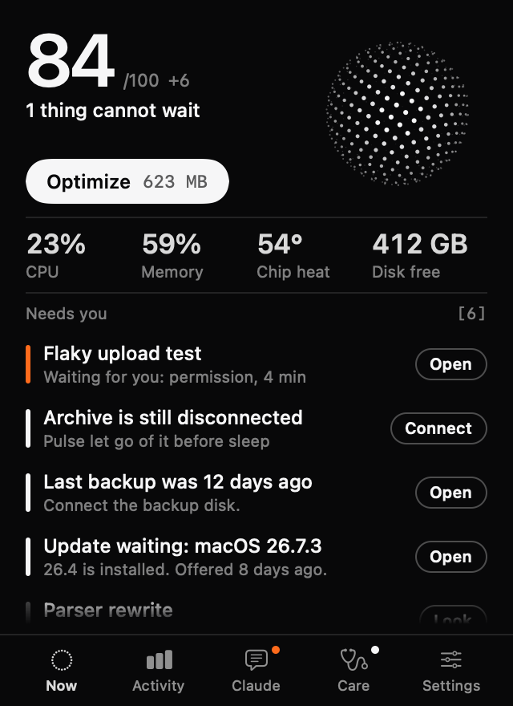
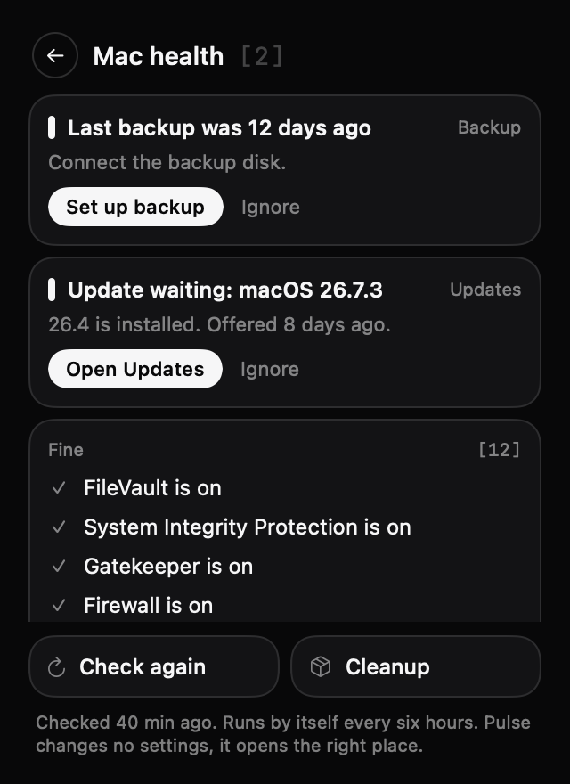

# Pulse

A small menu bar app for the load and the health of a Mac. One panel, one button that says
what it will do before it does it.

<p>
  
  
  
</p>

## What it does

- **Load.** CPU, memory, heat, and every process, grouped by app, each with its own close control.
- **Optimize.** Shows a plan first. Closes only what is ticked, and reports what happened.
- **The last twelve hours.** CPU time and peak memory of each row, counted while Pulse runs.
- **Health.** Backup, safety, updates, disk wear, battery, crashes, speed and startup items (those inside apps too), every six hours, as one score.
- **Cleanup.** Build and download caches that come back by themselves. To the Trash, never ticked in advance.
  Under them, the largest folders of your Library, to look at only.
- **Drives in sleep.** A drive you tick is unmounted before the Mac sleeps and mounted when it wakes.
- **Sleep.** What keeps the Mac awake, and what the last sleep cost.
- **Claude Code sessions**, when Claude Code is installed: which wait for you, which work, which are idle, what each one holds.
  On request, how much of the plan is used.
- **Simulators, emulators and build daemons**, each as one row, shut down with their own tools.
- **For agents.** A read-only MCP server.

## Install

Needs macOS 14 or later, Apple silicon or Intel.

1. Download the disk image from [Releases](https://github.com/shalevshafian/pulse/releases).
2. Drag Pulse to Applications and open it.

If its icon does not fit on the menu bar, open Pulse again from Applications: the panel opens in a window.

Or build it, with Xcode 16 or later:

```sh
git clone https://github.com/shalevshafian/pulse.git
cd pulse
./build.sh --install
```

## Privacy

Pulse has no network code, no telemetry and no accounts. It asks for no administrator rights.
It reads the process table, the sensors, the state of macOS's own tools and, if it exists,
`~/.claude/sessions`, where it opens only the `<pid>.json` records. What it keeps is in
`~/Library/Application Support/Pulse`: settings, health, the last sleeps, and the names and CPU time of
the last twelve hours.

Plan usage is off until you tick it. Then Pulse also reads `~/.claude.json`, which holds your account too, and
takes only the limits from it, and the end of recent files in `~/.codex/sessions`, only the lines with limits.

Opening a page of System Settings and the Releases link are the only things that leave the app,
and only when pressed.

## What Pulse will not do

- Close anything without a click. A single row takes two presses; Optimize takes a plan and a press.
- Close a Claude session that is working, or an app that is running one, from Optimize.
- Close Finder, Dock, WindowServer and other core parts of macOS, or a name on your own list.
- Signal a process by its number alone. The start time has to match, because numbers are reused.
- Delete. Cleanup moves to the Trash, from a fixed list, and refuses what is in use.
- Eject a drive, or force one that is in use. It stays connected and you are told what holds it.
- Change a setting of macOS. It opens the right page.

## MCP

```sh
claude mcp add --scope user pulse -- /Applications/Pulse.app/Contents/MacOS/Pulse --mcp
```

Or, for any client that takes a configuration file:

```json
{ "mcpServers": { "pulse": { "command": "/Applications/Pulse.app/Contents/MacOS/Pulse", "args": ["--mcp"] } } }
```

| Tool | Answers |
|---|---|
| `system_usage` | CPU, memory and pressure, swap, disk, heat |
| `claude_sessions` | Live sessions: idle, busy or waiting, for how long, how much memory |
| `top_cpu`, `top_memory` | What uses the machine most |
| `recent_load` | CPU time and peak memory of the last twelve hours |
| `sleep_blockers` | What keeps the Mac awake, and the last sleeps |
| `dev_runtimes` | Booted simulators, emulators, build daemons |
| `optimize_suggestions` | What could be closed. The user closes it, in the panel |
| `health_report` | The last health check |
| `plan_usage` | Claude and Codex limits, only when ticked in Settings |

All are read-only.

## Limits

- Heat is read from sensors Apple does not document. It works on Apple silicon; on an Intel Mac the number is left out.
- The trigger for drives is the Mac's sleep, not the lid. A closed lid with a display attached does not sleep the Mac.
- A cable pulled before the Mac has slept cannot be helped.
- Claude Code's session records and the saved plan limits are not public interfaces and may change. What cannot be read is left out.
- Of the startup items, only those loaded now can be seen. The full list needs an administrator.
- Disk wear is read from the Mac's own NVMe disk. For any other, the one word macOS gives stays.

## Development

```sh
swift test
swift build && .build/debug/Pulse --render page.png --page overview --demo
scripts/release.sh
```

See [CONTRIBUTING.md](CONTRIBUTING.md). Licensed under the [MIT License](LICENSE).
Pulse is an independent project, not affiliated with Apple or Anthropic.
